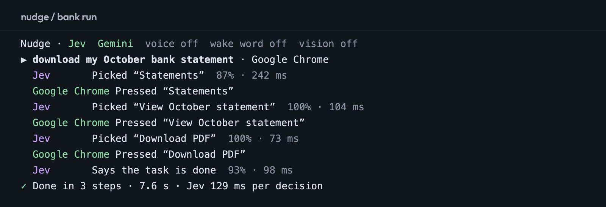

  

  
  
  
  

  <a href="docs/assets/nudge-launch.mp4">Launch video</a> ·
  <a href="#quick-start">Quick start</a> ·
  <a href="docs/SETUP.md">Setup and privacy</a> ·
  <a href="https://github.com/mekdimd/nudge/issues/new/choose">Report an issue</a> ·
  <a href="CONTRIBUTING.md">Contribute</a>

## What is Nudge?

Nudge is a desktop tool for people who find precise mouse clicks difficult. Type or say a goal. Nudge finds the next control, moves its large cursor, and acts one step at a time. Its bar shows what it is doing and asks when it needs your decision.

For example, ask Nudge to download your October bank statement. It opens Statements, selects the document and downloads the PDF. When you ask it to write an email, you can edit the draft and approve Send before it acts.

Nudge is a macOS and Windows prototype built at StormHacks 2026. App support depends on readable controls; the launch film uses a sample bank and mail page.

## See it run

[Watch the launch video](docs/assets/nudge-launch.mp4) for the statement download, YouTube search and email review. The GIF shows the complete bank flow with waiting shortened. The recordings use real model clients through a browser capture adapter and fictitious bank and mail data. See [capture details and music credits](docs/launch/ASSETS.md).

Terminal output from the bank run

These are the console lines from the same recording, rendered as a terminal image.

## Quick start

Install [uv](https://docs.astral.sh/uv/getting-started/installation/) on macOS or Windows. Nudge uses Python 3.12 or 3.13; uv can install it.

~~~bash
git clone https://github.com/mekdimd/nudge.git
cd nudge
uv sync --frozen
uv run nudge --offline gmail
~~~

The offline demo needs no keys or desktop permissions. It uses a scripted screen and does not control your computer.

Use Nudge with real apps

Copy [.env.example](.env.example) to .env and add your keys. Git ignores .env.

| Key | Purpose |
| --- | --- |
| TYPESAFE_API_KEY | Jev chooses the next control. Required for real tasks. |
| GEMINI_API_KEY | Drafts text for your review. Required for drafting. |

~~~bash
uv run nudge
~~~

On macOS, allow the terminal or editor in System Settings → Privacy & Security → Accessibility, then restart Nudge. On Windows, run Nudge and the target app without administrator privileges.

Real tasks send your goal and control details to Jev. [Setup and privacy](docs/SETUP.md) explains provider data use, voice, local vision and installation without uv.

## Use Nudge

Focus the app, summon the bar, and describe your task. Review drafts and confirmations. Press Esc or Stop to cancel.

| Platform | Summon the bar |
| --- | --- |
| macOS | ⌘⇧Space |
| Windows | Ctrl+Shift+Space |

Try goals that name the task and its destination:

~~~text
download my October bank statement
find a video on YouTube about how to change a tire
email prof.lee@sfu.ca that I'm sick and will miss today's lecture
~~~

Controls, confirmation and limits

- Peek outlines the controls Nudge can see. Blue marks accessibility controls, green marks text fields and orange marks local vision results.
- With voice configured, click the orb or say the wake word to speak. The mic button mutes the microphone.
- Nudge pauses before acting. You can edit drafts, and controls labelled Send, Delete, Buy, Pay and other consequential words require confirmation.
- If a choice is uncertain or an action changes nothing, Nudge asks for your help. It stops when another app takes focus and caps each run at 12 steps.

Confirmation depends on control labels. It cannot identify every consequential action in an unfamiliar app. Windows has an implementation, but end-to-end Windows results are not yet reported. [Demo notes](docs/DEMO.md) and [setup limits](docs/SETUP.md#support-and-limits) describe the tested scope.

## Contributing

[Report a bug](https://github.com/mekdimd/nudge/issues/new/choose), share accessibility feedback, or open a small PR. Include the OS, app, goal and step that failed. Remove keys and personal data from logs and screenshots. Read [CONTRIBUTING.md](CONTRIBUTING.md) before changing behavior.

Development and the editable video

~~~bash
uv run pytest -q
uv build
~~~

Tests use headless Qt, fake adapters and stubbed providers. They require no keys and do not operate your desktop.

The [HyperFrames project](docs/launch/README.md) contains the editable film, recording scripts and review notes.

## License

Nudge uses the [MIT license](LICENSE). Dependencies and media retain their own licenses. See [third-party notices](THIRD_PARTY_NOTICES.md) and [video credits](docs/launch/ASSETS.md).

Acknowledgments

Built with [PySide6](https://doc.qt.io/qtforpython-6/), TypeSafe's Jev, [Gemini](https://ai.google.dev/gemini-api/docs), [ElevenLabs](https://elevenlabs.io/docs), [openWakeWord](https://github.com/dscripka/openWakeWord) and [OmniParser](https://github.com/microsoft/OmniParser).

The README structure follows [Best-README-Template](https://github.com/othneildrew/Best-README-Template). The video uses [HyperFrames](https://github.com/heygen-com/hyperframes), Outfit and "Inspired" by Kevin MacLeod under [CC BY 4.0](https://creativecommons.org/licenses/by/4.0/).

[Back to top](#readme-top)
