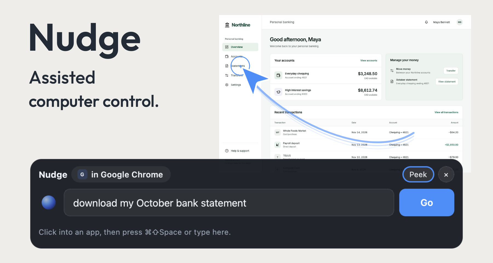
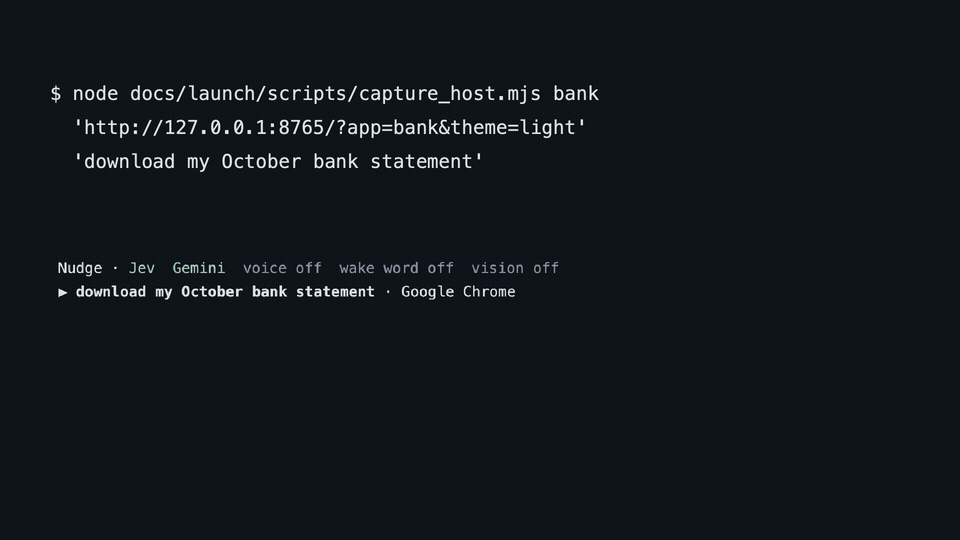
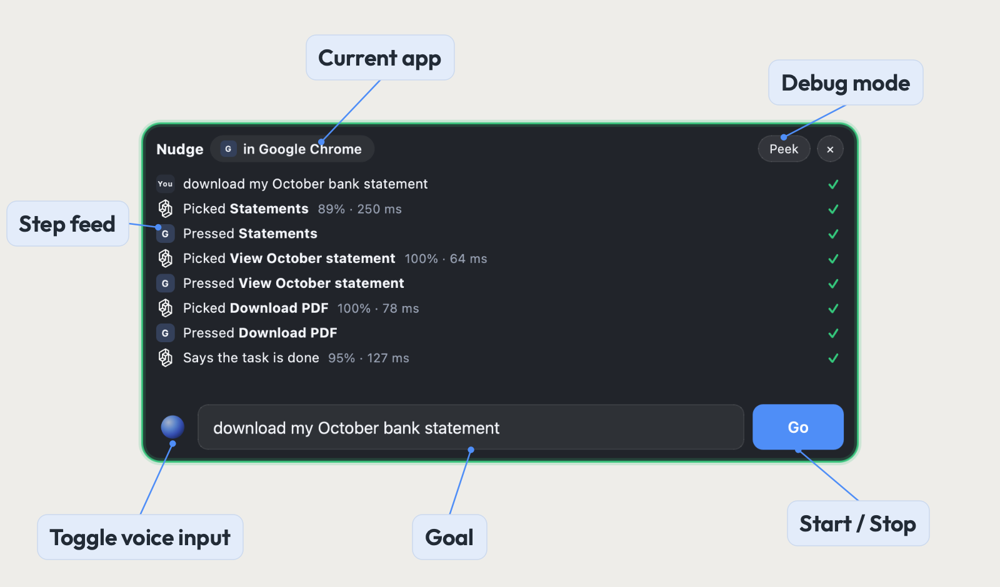

  

  
  
  
  

  <a href="docs/assets/nudge-launch.mp4">Launch video</a> ·
  <a href="#quick-start">Quick start</a> ·
  <a href="docs/SETUP.md">Setup and privacy</a> ·
  <a href="https://github.com/mekdimd/nudge/issues/new/choose">Report an issue</a> ·
  <a href="CONTRIBUTING.md">Contribute</a>

## What is Nudge?

Nudge is an accessibility assistant that lets you control your computer by voice or text. It is built for people with tremor, repetitive strain injuries, low vision or limited dexterity who want to use their existing apps without navigating every control by hand.

Describe what you want to do. Nudge reads the app's controls, chooses the next action and moves its large cursor to carry it out. It can draft and enter text, ask you to choose between uncertain options, and request approval before sensitive actions. Optional local vision finds controls that an app does not expose through accessibility APIs.

For example, ask Nudge to download your October bank statement. It opens Statements, selects the document and downloads the PDF. When you ask it to write an email, you can edit the draft and approve Send before it acts.

Nudge is a macOS and Windows prototype built at StormHacks 2026. Read the [Devpost write-up](https://devpost.com/software/nudge-nf7okh) for the project's background. App support depends on readable controls; the launch film uses a sample bank and mail page.

## See it run

[Watch the launch video](docs/assets/nudge-launch.mp4) for the statement download, Excel tutorial playback on YouTube, Jev control selection and email review. The GIF shows the complete bank flow with waiting shortened. The recordings use real model clients through a browser capture adapter and fictitious bank and mail data. See [capture details and music credits](docs/launch/ASSETS.md).

Photos

Terminal output from the bank recording.

## Quick start

Install [uv](https://docs.astral.sh/uv/getting-started/installation/) on macOS or Windows. Nudge uses Python 3.12 or 3.13; uv can install it.

~~~bash
git clone https://github.com/mekdimd/nudge.git
cd nudge
uv sync --frozen
uv run nudge --offline gmail
~~~

The offline demo needs no keys or desktop permissions. It uses a scripted screen and does not control your computer.

Use Nudge with real apps

Copy [.env.example](.env.example) to .env and add your keys.

| Key | Purpose |
| --- | --- |
| TYPESAFE_API_KEY | Jev chooses the next control. Required for real tasks. |
| GEMINI_API_KEY | Drafts text for your review. Required for drafting. |

~~~bash
uv run nudge
~~~

On macOS, allow the terminal or editor in System Settings → Privacy & Security → Accessibility, then restart Nudge. On Windows, run Nudge and the target app without administrator privileges.

Real tasks send your goal and control details to Jev. [Setup and privacy](docs/SETUP.md) explains provider data use, voice, local vision and installation without uv.

## Use Nudge

1. Open the app you want to use and bring its window to the front.
2. Start Nudge with `uv run nudge`, then return to your app. Summon the bar with <kbd>⌘</kbd> + <kbd>⇧</kbd> + <kbd>Space</kbd> on macOS, or <kbd>Ctrl</kbd> + <kbd>Shift</kbd> + <kbd>Space</kbd> on Windows.
3. Type your goal and press Go. With voice configured, click the orb or say your wake word, then speak your request.
4. Review drafts and edit them before approving. If Nudge asks which control you mean, choose an option to continue.
5. Press <kbd>Esc</kbd> or Stop to cancel a task.

Try goals that name the task and its destination:

~~~text
download my October bank statement
play a tutorial on YouTube about Excel pivot tables
email prof.lee@sfu.ca that I'm sick and will miss today's lecture
~~~

Command line, voice and vision

The CLI launches the bar. Enter your goal there, or speak it when voice is configured.

~~~bash
uv run nudge --help          # Show all options.
uv run nudge --debug         # Open with Peek debug mode enabled.
uv run nudge --background    # Run in the background.
uv run nudge --stop          # Quit a background or persistent instance.
uv run nudge --offline gmail # Try the scripted demo without keys.
~~~

Use `--persistent` to keep Nudge in the terminal while the close button hides the bar. The hotkey brings it back. Press Ctrl+C to quit a foreground instance.

For voice input and spoken approval prompts, set `ELEVENLABS_API_KEY` in .env. To use "Hey Nudge" as the wake word, set `WAKE_WORD=models/hey_nudge.onnx`; the default is "Hey Jarvis." The orb starts or stops listening. The mic button mutes the microphone, and its menu selects the microphone and controls spoken replies.

To enable the local vision fallback:

~~~bash
uv sync --frozen --extra vision
uv run --extra vision nudge
~~~

Nudge uses vision when the app exposes too few accessibility controls. Model weights download on first launch, and screenshots stay on your computer. The resulting control labels go to Jev. Start with `uv run nudge --no-vision` to disable it.

[Setup and privacy](docs/SETUP.md) covers configuration, model downloads and provider data use.

Controls, confirmation and limits

- Peek outlines the controls Nudge can see. Blue marks accessibility controls, green marks text fields and orange marks local vision results.
- With voice configured, click the orb or say the wake word to speak. The mic button mutes the microphone.
- Nudge pauses before acting. You can edit drafts, and controls labelled Send, Delete, Buy, Pay and other consequential words require confirmation.
- If a choice is uncertain or an action changes nothing, Nudge asks for your help. It stops when another app takes focus and caps each run at 12 steps.

Confirmation depends on control labels. It cannot identify every consequential action in an unfamiliar app. Windows has an implementation, but end-to-end Windows results are not yet reported. [Demo notes](docs/DEMO.md) and [setup limits](docs/SETUP.md#support-and-limits) describe the tested scope.

## Contributing

[Report a bug](https://github.com/mekdimd/nudge/issues/new/choose), share accessibility feedback, or open a small PR. Include the OS, app, goal and step that failed. Remove keys and personal data from logs and screenshots. Read [CONTRIBUTING.md](CONTRIBUTING.md) before changing behavior.

Development and the editable video

~~~bash
uv run pytest -q
uv build
~~~

Tests use headless Qt, fake adapters and stubbed providers. They require no keys and do not operate your desktop.

The [HyperFrames project](docs/launch/README.md) contains the editable film, recording scripts and review notes.

## License

Nudge uses the [MIT license](LICENSE). Dependencies and media retain their own licenses. See [third-party notices](THIRD_PARTY_NOTICES.md) and [video credits](docs/launch/ASSETS.md).

Acknowledgments

Built with [PySide6](https://doc.qt.io/qtforpython-6/), TypeSafe's Jev, [Gemini](https://ai.google.dev/gemini-api/docs), [ElevenLabs](https://elevenlabs.io/docs), [openWakeWord](https://github.com/dscripka/openWakeWord) and [OmniParser](https://github.com/microsoft/OmniParser).

The README structure follows [Best-README-Template](https://github.com/othneildrew/Best-README-Template). The video uses [HyperFrames](https://github.com/heygen-com/hyperframes), Outfit and "Inspired" by Kevin MacLeod under [CC BY 4.0](https://creativecommons.org/licenses/by/4.0/).

[Back to top](#readme-top)
