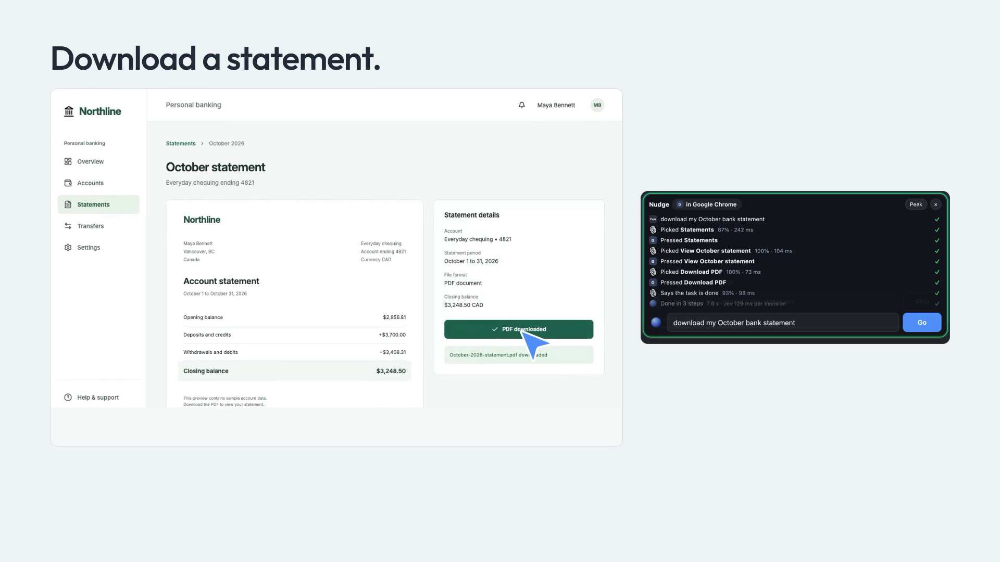
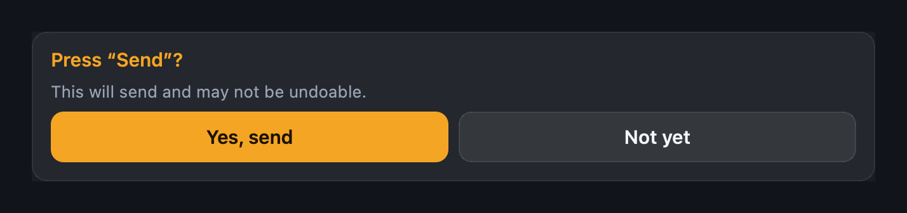

  

<h1 align="center">Nudge</h1>

  Desktop assistance for people who find precise mouse work tiring or painful. 
  Type or say your goal. Nudge finds the next control and acts one step at a time.

  
  
  
  

  <a href="docs/assets/nudge-launch.mp4">Watch the launch video</a> ·
  <a href="#quick-start">Quick start</a> ·
  <a href="docs/DEMO.md">Demo walkthrough</a> ·
  <a href="https://github.com/mekdimd/nudge/issues/new/choose">Report an issue</a> ·
  <a href="CONTRIBUTING.md">Contribute</a>

## See it in action

[Watch the 30-second launch video](docs/assets/nudge-launch.mp4). The recording script uses Nudge's real task loop and model clients with a browser adapter. The bank and mail pages use sample data, and the video search uses a public page. These edited captures do not establish support for every bank or measure native desktop performance. See [capture details and music credits](docs/launch/ASSETS.md).

Contents

- [Why Nudge](#why-nudge)
- [Quick start](#quick-start)
- [Use Nudge](#use-nudge)
- [You stay in control](#you-stay-in-control)
- [How it works](#how-it-works)
- [Tested workflows and limits](#tested-workflows-and-limits)
- [Privacy](#privacy)
- [Development](#development)
- [Contributing](#contributing)
- [License](#license)
- [Acknowledgments](#acknowledgments)

## Why Nudge

Small buttons and deeply nested settings can make everyday tasks difficult for people with tremor, RSI or low vision. Nudge lets you describe the task instead of finding and hitting each control yourself. Its large cursor moves to the next target, pauses so you can stop it, and then acts. The bar shows each step and asks when it needs your decision.

Nudge is a prototype built at StormHacks 2026. It works within one app at a time. See the [tested workflows](#tested-workflows-and-limits) before relying on it for a new task.

## Quick start

You need macOS or Windows and [uv](https://docs.astral.sh/uv/getting-started/installation/). Nudge requires Python 3.12 or 3.13; uv can install it.

~~~bash
git clone https://github.com/mekdimd/nudge.git
cd nudge
uv sync --frozen
~~~

Try the interface without API keys or desktop permissions:

~~~bash
uv run nudge --offline live_caption
uv run nudge --offline gmail
~~~

To use real apps, configure the keys and platform permissions below.

Setup for real apps and optional features

Copy the example configuration and add your keys for real apps:

~~~bash
# macOS
cp .env.example .env

# Windows PowerShell
Copy-Item .env.example .env
~~~

| Setting | Purpose | Required |
| --- | --- | --- |
| `TYPESAFE_API_KEY` | Jev chooses the next control | For real tasks |
| `GEMINI_API_KEY` | Drafts text and web addresses for review | For drafting |
| `ELEVENLABS_API_KEY` | Voice input and spoken prompts | Optional |
| `ELEVENLABS_VOICE_ID` | Voice used for spoken prompts | Optional |
| `WAKE_WORD` | Bundled wake model name or ONNX model path | Optional, defaults to `hey_jarvis` |
| `WAKE_THRESHOLD` | Wake detection threshold | Optional, defaults to `0.5` |

Keep keys in `.env`. Git ignores that file.

~~~bash
uv run nudge
~~~

If you configured both TypeSafe and Gemini, verify both services with the smoke script. It makes real API calls and requires both keys. Skip it if you configured only TypeSafe.

~~~bash
uv run python scripts/smoke.py
~~~

### Platform setup

| | macOS | Windows |
| --- | --- | --- |
| Permission | System Settings → Privacy & Security → Accessibility. Allow the terminal or editor that launches Nudge, then restart Nudge. | Run Nudge and the target app without administrator privileges. A normal process cannot control an elevated app. |
| Summon the bar | ⌘⇧Space | Ctrl+Shift+Space |
| Stop a task | Esc or the Stop button | Esc or the Stop button |

### Optional vision fallback

Some apps expose few accessibility controls. Install local vision to help Nudge read their windows:

~~~bash
uv sync --extra vision
uv run nudge
uv run nudge --no-vision  # skip vision even when installed
~~~

This adds PyTorch, Ultralytics and Transformers. Allow a few GB of disk space and about 3 GB of RAM while running. OmniParser weights download from Hugging Face on first launch. Models warm up in the background, which the original project notes estimate at about 15 seconds.

Install without uv

Use Python 3.12 or 3.13:

~~~bash
python -m venv .venv
~~~

Activate the environment:

~~~bash
# macOS
source .venv/bin/activate

# Windows PowerShell
.venv\Scripts\Activate.ps1
~~~

~~~bash
pip install -r requirements.txt
python -m nudge
~~~

Copy `.env.example` to `.env` for real tasks. For vision, also install `requirements-vision.txt`.

## Use Nudge

1. Focus the app you want help with.
2. Summon Nudge with the hotkey. The bar identifies the target app.
3. Type a goal and press Enter. With voice configured, click the orb or use the configured wake word to speak.
4. Follow the step feed. Review drafts and answer any questions. Press Stop or Esc at any point.

Goals from the demo notes and launch recording:

~~~text
download my October bank statement
email prof.lee@sfu.ca that I'm sick and will miss lecture
find a video on how to change a tire
play Olivia Rodrigo
~~~

The mic button mutes the microphone. Its arrow chooses a microphone and toggles voice and sound effects. The orb shows when Nudge is listening; click it again to stop listening.

Background mode and debugging

### Run in the background

~~~bash
uv run nudge --background
uv run nudge --stop
~~~

The close button hides the background bar. The hotkey brings it back, and the menu bar or tray icon offers Show and Quit. Use `--persistent` for the same close-to-hide behavior without detaching from the terminal.

Logs go to `~/Library/Logs/Nudge` on macOS and `%LOCALAPPDATA%\Nudge` on Windows. Ctrl+C quits when Nudge is attached to the terminal.

### Inspect what Nudge can see

Click **Peek**, or launch with `uv run nudge --debug`. Blue outlines mark accessibility controls, green marks text fields, orange marks vision detections, and white marks Jev's choice.

## You stay in control

Nudge pauses before acting, lets you edit drafts, and asks before controls labelled Send, Delete, Buy and other consequential actions. Stop and Esc interrupt a run.

Confirmation rules and recovery

- Nudge holds the cursor for half a second before acting. Stop and Esc can interrupt the run.
- Controls labelled send, delete, buy, pay, submit and other consequential words require confirmation.
- You can edit a draft before Nudge types it. The writer blanks email addresses that were not in your goal.
- When Jev's top choice is below 35%, or leads the runner-up by less than 6 percentage points, you choose among the leading options.
- If an action changes nothing, you choose Retry, Click it instead or Pick another. Nudge does not retry it on its own.
- Nudge stops when a different app takes focus. Each run is capped at 12 steps.

Confirmation uses control labels. It cannot guarantee that every consequential action in an unfamiliar app will have a matching label.

How it works

| Stage | What happens |
| --- | --- |
| Read | The macOS accessibility tree or Windows UI Automation supplies named controls and their positions. |
| Choose | Jev receives your goal, the controls and prior steps. It ranks possible actions and decides whether the task is done. |
| Review | Nudge asks for uncertain choices, draft edits and consequential actions. |
| Act | The enlarged cursor moves to the chosen control and pauses. Nudge uses the accessibility API, or a click for a vision target. |
| Verify | Nudge waits for the screen to change and browser loading to finish, then repeats. |

Gemini runs when text or an address must be drafted. It does not choose which control to press.

When the accessibility tree is sparse or Jev cannot find a control, Nudge can run [OmniParser v2](https://huggingface.co/microsoft/OmniParser-v2.0) locally. YOLO finds icons, Apple Vision or RapidOCR reads text, and Florence-2 names unlabeled icons. Jev then chooses from the combined labels. Confident decisions on a normal accessibility tree do not require vision.

Tested workflows and limits

The original demo notes report these end-to-end runs on macOS. The launch recording exercises the task loop through a browser capture adapter. The bank and mail pages are controlled demos. These captures do not repeat native desktop app tests. Windows has an implementation, but the original notes do not yet report end-to-end Windows results.

| Workflow | Reported macOS result | Windows end-to-end result |
| --- | --- | --- |
| Chrome Live Caption | 2 steps, about 4 seconds | Not reported |
| Gmail draft and confirmed Send | 3 steps, about 8 seconds | Not reported |
| YouTube tire-changing video search | 2 to 3 steps, about 10 seconds | Not reported |
| Spotify artist playback with vision | 3 steps, about 11 seconds | Not reported |

These are historical demo observations, not benchmarks or guarantees. Offline Live Caption follows a separate four-step fixture.

- App support depends on usable accessibility labels or visible controls that local vision can recognize.
- Vision-generated icon names can be wrong. Expect more requests for your help in those apps.
- Controls that appear only on hover may be invisible to Nudge.
- Tasks that switch apps stop when the target app changes.
- Testing so far uses English labels. Linux is not supported.

Privacy

| Component | What leaves your computer |
| --- | --- |
| Jev | Your goal, app and window names, control labels, roles, positions, context, non-text values, and prior step descriptions |
| Gemini | Your goal, window title and empty field names when drafting; your goal when drafting an address |
| Local vision | No screenshot. The target window is processed locally; its resulting labels go to Jev. |
| ElevenLabs, when enabled | Microphone audio for transcription and prompt text for spoken replies |

Password fields are not read. Provider icons in the step feed explain their data use. Logs include task and action details, so review them before attaching them to an issue.

Development

~~~bash
uv sync --frozen
uv run pytest -q
uv build
~~~

Tests use headless Qt, fake platform adapters and stubbed providers. They do not require API keys or operate your desktop.

| Directory | Responsibility |
| --- | --- |
| `nudge/core/` | Actions, Jev, drafting, safety, verification and the task loop |
| `nudge/platform/` | macOS AX, Windows UI Automation and the fake adapter |
| `nudge/vision/` | Window capture, OCR, detection and icon captions |
| `nudge/ui/` | Qt bar, step feed, cursor overlay and voice controls |
| `tests/` | Unit tests, UI tests and offline fixtures |
| `docs/launch/` | Editable HyperFrames film, assets and reproduction scripts |

Read [CONTRIBUTING.md](CONTRIBUTING.md) for the development workflow. To inspect a real target app without pressing its controls:

~~~bash
uv run python scripts/check_platform.py --show
~~~

For the video's source, review notes and render commands, see [the launch project](docs/launch/README.md).

## Contributing

Bug reports, accessibility feedback, platform test results and small pull requests help us identify what works. Start with the [contribution guide](CONTRIBUTING.md) or [open an issue](https://github.com/mekdimd/nudge/issues/new/choose). Include the OS, app, goal, expected result and the step where Nudge stopped. Remove keys and personal data from logs and screenshots.

## License

Nudge uses the [MIT license](LICENSE). Third-party models, libraries, fonts and artwork retain their own licenses. See the [video asset credits](docs/launch/ASSETS.md) for the launch film.

Acknowledgments

Built at StormHacks 2026 with [PySide6](https://doc.qt.io/qtforpython-6/), TypeSafe's Jev, [Gemini](https://ai.google.dev/gemini-api/docs), [ElevenLabs](https://elevenlabs.io/docs), [openWakeWord](https://github.com/dscripka/openWakeWord) and [OmniParser](https://github.com/microsoft/OmniParser).

The README structure follows [Best-README-Template](https://github.com/othneildrew/Best-README-Template). The launch film uses [HyperFrames](https://github.com/heygen-com/hyperframes) and the [Outfit font](https://github.com/Outfitio/Outfit-Fonts). Music: "Cloud Dancer" by Kevin MacLeod, [CC BY 4.0](https://creativecommons.org/licenses/by/4.0/). The film uses an edited excerpt.

[Back to top](#readme-top)
